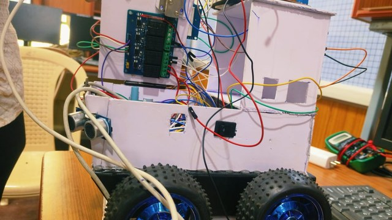
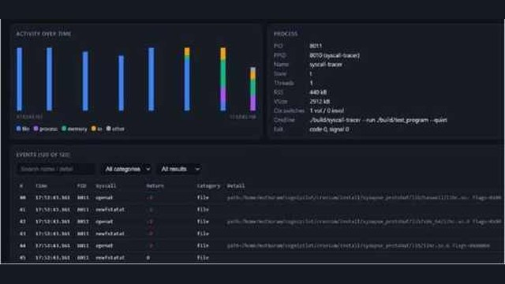
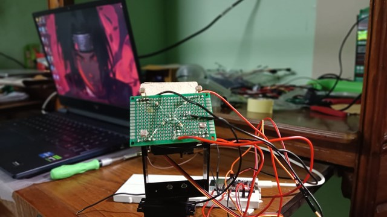

# Muthuraman M

**Electronics and Communication Engineering student**  
Embedded systems · Linux systems programming · Robotics & signal processing

I build projects that connect hardware, software, and measurement. My work spans ESP32 and Raspberry Pi prototypes, MATLAB simulations, Linux instrumentation, and web tools for monitoring or interacting with those systems.

[LinkedIn](https://www.linkedin.com/in/muthuraman-m326/) · [Instagram](https://www.instagram.com/muthuram_326/) · [All repositories](https://github.com/Muthuram30?tab=repositories)

[`Python`](https://github.com/topics/python) · [`Embedded Systems`](https://github.com/topics/embedded-systems) · [`Linux`](https://github.com/topics/linux) · [`ESP32`](https://github.com/topics/esp32) · [`Robotics`](https://github.com/topics/robotics) · [`MATLAB`](https://github.com/topics/matlab)

## Featured projects

| Project | What it does | Tools |
| --- | --- | --- |
| **[CAN Intrusion Detection](https://github.com/Muthuram30/Can_ids)** | Connects a Raspberry Pi gateway to three ESP32 ECUs over CAN. A Flask dashboard displays live bus and sensor activity, and an Isolation Forest mode flags unusual traffic in the lab testbed. | Raspberry Pi, ESP32, SocketCAN, Flask, scikit-learn |
| **[2D SLAM Simulation](https://github.com/Muthuram30/SLAM)** | Simulates virtual LiDAR and builds an indoor occupancy map with autonomous waypoint exploration and pose-graph loop closure. | MATLAB, LiDAR, occupancy grids |
| **[Linux Syscall Tracer](https://github.com/Muthuram30/Linux_Syscall_Tracer)** | Traces system calls with `ptrace()`, reads process data from `/proc`, and shows captured events and resource usage in a Flask dashboard. | Linux, C, Python, Flask |
| **[VoiceLab](https://github.com/Muthuram30/Voice_Clone)** | Runs speaker-conditioned speech synthesis locally, with separate enrollment profiles and CUDA-based audio processing. | Python, Flask, PyTorch, CUDA |
| **[Dual-Axis Solar Tracker](https://github.com/Muthuram30/Solar_tracker)** | Uses four light-dependent resistors and two servo motors to orient a solar panel toward the brightest direction. | ESP32, LDRs, servo control |
| **[TravelEase](https://github.com/Muthuram30/TravelEase)** | A tourism platform for exploring Indian destinations, booking tour packages, and getting explainable recommendations. | React, PHP, MySQL, MapLibre GL |

  
  
  

## Other projects

- **Embedded and simulation** · [Parkinson’s Spoon Stabilizer](https://github.com/Muthuram30/Parkinsons_spoon) uses an MPU6050 and two servos in an assistive prototype. [Smart Campus Navigation](https://github.com/Muthuram30/Smart-Navigation-System) models routes with Dijkstra and BFS. [Robot Model and Simulator](https://github.com/Muthuram30/robot-model-and-simulator) simulates movement, battery use, and undo/redo on a 2D grid.
- **Media and data** · [StreamIQ](https://github.com/Muthuram30/streamiq) is a local video library with FFmpeg-generated data-saving copies and playback resume. [AuraBeat](https://github.com/Muthuram30/MUSIC-MOOD-CLASSIFIER) classifies music mood with Random Forest. [Agricultural Market Dashboard](https://github.com/Muthuram30/Streamlit_dashboard) explores Indian commodity prices using AGMARKNET data.
- **Self-hosting** · [Nextcloud Homelab](https://github.com/Muthuram30/Nextcloud_Homelab) documents deploying and running Nextcloud AIO with Docker and Cloudflare Tunnel.
- **Practice repositories** · [ATM Simulation in C](https://github.com/Muthuram30/ATM-SIMULATION-SYSTEM) · [Arduino](https://github.com/Muthuram30/Arduino) · [Python Programs](https://github.com/Muthuram30/python-programs) · [Classroom](https://github.com/Muthuram30/Classroom)

## Tools and interests

| Area | Languages and tools |
| --- | --- |
| Embedded and digital design | C, Verilog, ESP32, Arduino, Raspberry Pi, CAN, sensor interfacing |
| Modelling and signal processing | MATLAB, Simulink, LiDAR, DSP, IMU sensor fusion |
| Systems and web | Python, Linux, Flask, Streamlit, React, PHP, MySQL, SQLite, Docker, Git |
| Machine learning | scikit-learn, PyTorch, CUDA |
